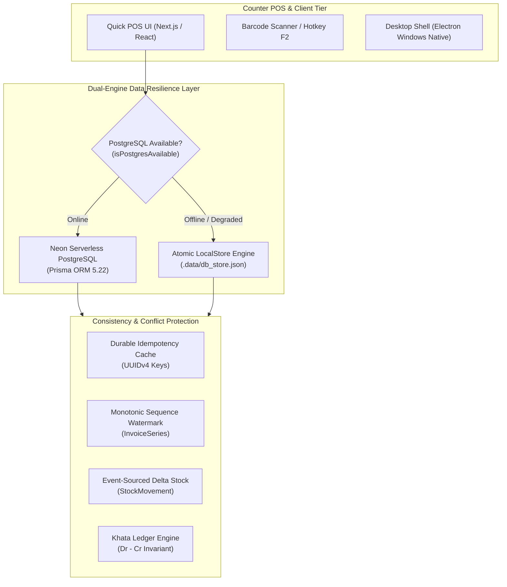
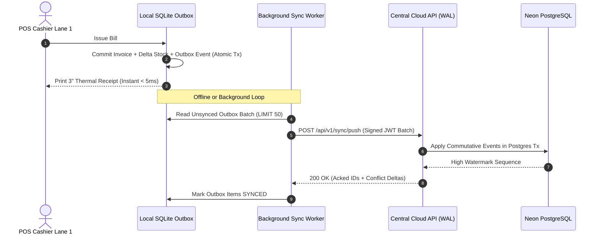

# AutoLedger ERP — System Architecture & Dual-Engine Design

> **Why Offline-First Matters for Counter Billing, How Invariants Are Preserved, and the Architectural Roadmap to v2.**

---

## 1. Executive Summary & Problem Statement

AutoLedger ERP is engineered specifically for **automotive spare parts dealerships, two-wheeler workshops, and wholesale distributors**. Unlike standard generic SaaS CRMs or e-commerce storefronts, automotive spare parts counters operate under physical retail and wholesale dynamics that punish cloud-only architectures:

1. **Physical Counter Throughput (6:30 PM Peak Rush):** At peak evening hours in wholesale spare parts markets (e.g., Nana Peth Pune, Kashmiri Gate Delhi, Grant Road Mumbai), mechanics, garage owners, and counter staff conduct 15–30 transactions per minute. Counter technicians demand sub-10ms UI responses for barcode scanning, SKU lookup, and cash drawer triggers.
2. **Connectivity Volatility:** Dense commercial markets frequently suffer from Wi-Fi dropouts, cellular congestion, ISP switchovers, and transient latency spikes.
3. **The Business Invariant:** **The billing desk must NEVER freeze.** A 1,200ms cloud round-trip delay creates physical queues out the door. A `500 Internal Server Error` or `504 Gateway Timeout` prevents the customer from walking out with parts, halting physical trade.

To solve this, AutoLedger ERP implements a **Dual-Engine Architecture** balancing sub-millisecond local speed with resilient multi-device cloud synchronization.

---

## 2. Dual-Engine Architecture (v1: Current Implementation)

### 2.1 Storage Tiers

AutoLedger maintains two synchronized storage planes:

| Attribute | Cloud Engine (Neon PostgreSQL) | Local Engine (Atomic LocalStore) |
| :--- | :--- | :--- |
| **Primary Role** | Global source of truth, cross-device sync, B2B Khata aging | Zero-latency counter billing, instant fallback during network drop |
| **Data Format** | Relational schema (37 normalized tables with foreign keys) | Atomic JSON file (`.data/db_store.json`) with in-memory indexes |
| **Monetary Precision** | `BigInt` Paise (1 INR = 100 Paise) to eliminate IEEE-754 float drift | String-encoded integer Paise (`"18500"` = ₹185.00) |
| **Query Latency** | 40ms – 120ms (over TLS) | **< 1ms** (in-process memory buffer) |
| **Availability Guarantee** | Depends on WAN & serverless container readiness | **100% Local Uptime** (runs on counter PC localhost / Electron) |

### 2.2 Health Probing & Zero-Latency Routing

Every request to the API route boundary (`app/api/v1/*`) passes through `isPostgresAvailable()`:
- Cached connectivity probe with a 5-second TTL.
- If PostgreSQL connection pool reports healthy, the request routes to Prisma.
- If the network drops or Neon experiences a cold start timeout, execution routes smoothly to `localStore` without throwing 500 errors to the cashier.

---

## 3. Consistency Invariants & Conflict Resolution Model

A common critique of dual-store architectures is data divergence: *"What happens if the local counter bills an item while offline, and how are conflicts resolved?"* AutoLedger answers this through **four strict architectural invariants**:

### 3.1 Invariant A: Invoices Are Append-Only, Immutable Business Records
In physical retail and wholesale billing, **invoices are legal records and are never mutated in place**. 
* Once bill `#INV-2026-0042` is printed and handed to a workshop owner, its line items, rates, and totals are sealed.
* Adjustments are made via **compensating transactions** (cancellation events or credit notes), never an `UPDATE` on invoice lines.
* Because invoices are append-only, concurrent writes between cloud and local do not overwrite existing invoice state.

### 3.2 Invariant B: Monotonic Sequence Watermarking
* To prevent colliding bill numbers across offline sessions, `InvoiceSeries` preserves a monotonic counter.
* When offline, invoice numbers generate using a timestamp-monotonic sequence (`INV-<YYMM>-<NUM>`).
* Upon reconciliation or database restore, the sequence watermark adopts:
  $$\text{NextNumber} = \max(\text{CloudLastNumber}, \text{LocalLastNumber}) + 1$$
* This mathematically guarantees that bill numbers never collide or regress.

### 3.3 Invariant C: Event-Sourced Delta Stock Movements
Naive inventory systems update stock using absolute values:
$$\text{stock} = \text{newStock} \quad \text{(Vulnerable to clobbering)}$$

AutoLedger uses **event-sourced delta movements** (`StockMovement`):
$$\Delta \text{Stock} \in \mathbb{Z} \quad \text{with Reason} \in \{\text{OPENING}, \text{PURCHASE}, \text{SALE}, \text{RETURN}, \text{ADJUSTMENT}\}$$
* A POS sale creates an atomic movement with $\text{qty} = -2$.
* When cloud synchronization occurs, the ledger calculates:
  $$\text{CurrentStock} = \sum_{i} \text{movement}_i.\text{qty}$$
* Even if an offline cashier sold 2 units while a bulk inventory upload added 50 units online, both operations commute:
  $$(50 + (-2)) = ((-2) + 50) = 48$$
* Commutative addition eliminates write-write conflicts on product quantities.

### 3.4 Invariant D: Durable Idempotency Keys
* Every invoice creation and payment request requires a client-generated UUIDv4 `idempotencyKey`.
* If a network hiccup causes the POS client to retry a submission, the server checks the idempotency cache:
  - If already processed: Returns the existing invoice payload with HTTP 200/201.
  - Skips duplicate stock deduction and prevents double ledger entries.

### 3.5 Invariant E: Double-Entry Khata Parity
Customer credit (Udhar) and payments adhere to double-entry ledger bookkeeping:
$$\text{CustomerBalance} = \sum \text{Debit (Bills)} - \sum \text{Credit (Payments)}$$
Aging analysis (0-30d, 31-60d, 61-90d, 90+d) is computed on demand from chronological ledger records, ensuring zero floating-point accumulation errors.

---

## 4. The Architectural Roadmap to v2

While v1's direct-to-cloud with localStore fallback handles single-lane dealerships with zero counter downtime, **AutoLedger v2** introduces a formal distributed synchronization protocol designed for multi-lane dealerships operating concurrently across offline devices.

### Key Pillars of v2:

1. **Transactional Outbox Pattern:**
   * Every local mutation writes to a local SQLite/IndexedDB `outbox_events` table within the same ACID transaction as the local business entity.
   * State is always consistent on the local machine before any network call is attempted.

2. **Centralized Append-Only `SyncLog` (Write-Ahead Log):**
   * The central database assigns an auto-incrementing monotonic sequence ID to all synced events.
   * Clients track a `last_synced_sequence_id`. Pulling updates is an efficient query:
     `SELECT * FROM sync_log WHERE tenant_id = $1 AND sequence_id > $last_synced_id ORDER BY sequence_id ASC`

3. **Multi-Lane Conflict Resolution via Vector Clocks:**
   * For dealerships with multiple cashier terminals (Lane 1, Lane 2, Parts Room):
   * Each lane has a discrete terminal identifier.
   * Concurrent sales of the last remaining part are resolved using monotonic vector timestamps: the first received transaction captures the part; the subsequent transaction flags a non-blocking `NEGATIVE_STOCK_ALERT` in the inventory audit log for manager reorder, rather than crashing the POS till.

4. **Dead-Letter Queue (DLQ) & Visual Reconciliation Workspace:**
   * Unresolvable schema discrepancies or invalid foreign keys are isolated in a `sync_quarantine` table.
   * Dealership Owners can inspect, re-map, or resolve quarantined items from `/settings/sync-audit` without technical database intervention.

---

## 5. Architectural Trade-Off Analysis

| Architectural Choice | Benefit | Trade-Off & Mitigation |
| :--- | :--- | :--- |
| **Dual Storage (Neon + LocalStore)** | 100% counter uptime; zero downtime during WAN dropouts. | Dual-write maintenance overhead; mitigated by unifying schemas and encapsulating fallback logic in route helpers. |
| **Paise (BigInt) Accounting** | Eliminates rounding errors and GST mismatch down to 0.01 INR. | Requires serializing BigInt to string in JSON payloads; handled via standardized DTO boundaries. |
| **Event-Sourced Inventory Movements** | Commutative merging; full traceability for stock audit. | Slightly higher row volume; mitigated by monthly stock snapshot compaction. |
| **Client-Side Barcode & Part Caching** | Instant keystroke search across 25,000+ SKUs. | Initial catalog download size (~1MB); mitigated by gzip/brotli compression and indexed memory search. |

---

## 6. Verification & Automated Test Coverage

The architecture is continuously verified through an automated test suite enforcing financial invariants, concurrency boundaries, and tenant isolation:

* `tests/financialIntegrity.test.ts`: Proves ledger balance parity and atomic rollback.
* `tests/durableIdempotencyAndStockSafety.test.ts`: Verifies duplicate requests never double-decrement inventory.
* `tests/backupRestoreDR.test.ts`: Tests point-in-time snapshot exports and cross-tenant collision rejection.
* `tests/tenantIsolation.test.ts`: Proves complete multi-tenant cryptographic and relational isolation across all CRUD boundaries.
