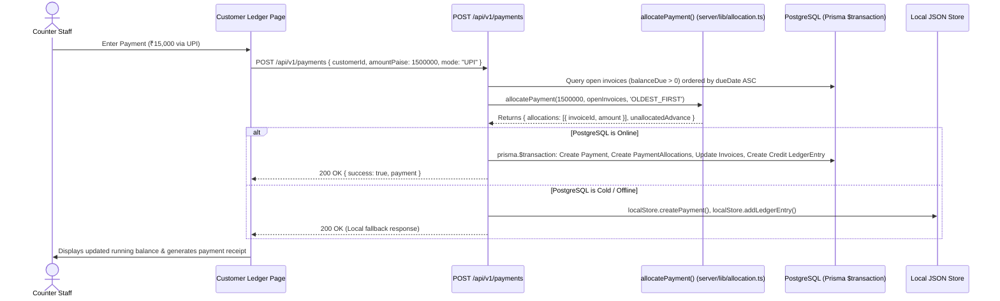

# 02. Architecture & Data Flow Reference

## 1. High-Level System Architecture

```mermaid
graph TD
    subgraph ClientLayer ["Client & Interface Layer"]
        BrowserUI["Web Browser (Next.js 14 App Router)"]
        ElectronApp["Electron Desktop App (Windows Native)"]
        CustomerPortal["B2B Customer Mobile Portal"]
    end

    subgraph EdgeLayer ["Edge & Middleware"]
        EdgeMiddleware["middleware.ts (IP Rate Limiting: 100 req/min)"]
    end

    subgraph ServerLayer ["Next.js Server (API Routes & Server Libs)"]
        APIHandlers["API v1 Route Handlers (app/api/v1/*)"]
        AuthModule["Auth & Session (server/lib/auth.ts)"]
        TaxEngine["Tax & GST Engine (server/lib/tax.ts)"]
        AllocEngine["FIFO Allocation Engine (server/lib/allocation.ts)"]
        SyncWorker["Cloud Sync Worker (server/lib/cloudSync.ts)"]
    end

    subgraph DataLayer ["Dual-Engine Persistence Layer"]
        PrismaORM["Prisma Client ORM (server/lib/prisma.ts)"]
        PostgresDB[("PostgreSQL Database (Neon / Cloud / Local)")]
        LocalStore["Atomic Local Store (server/lib/store.ts)"]
        LocalFile[(".data/db_store.json (Local Atomic Cache)")]
    end

    subgraph ExternalServices ["External Integrations"]
        RazorpayGW["Razorpay Payment Gateway (UPI / QR / Webhooks)"]
        WhatsAppShare["WhatsApp Click-to-Chat (wa.me link generation)"]
    end

    BrowserUI --> EdgeMiddleware
    ElectronApp --> EdgeMiddleware
    CustomerPortal --> EdgeMiddleware
    EdgeMiddleware --> APIHandlers

    APIHandlers --> AuthModule
    APIHandlers --> TaxEngine
    APIHandlers --> AllocEngine

    APIHandlers -->|Check isPostgresAvailable()| PrismaORM
    PrismaORM --> PostgresDB
    APIHandlers -->|Fallback when Postgres cold/offline| LocalStore
    LocalStore --> LocalFile
    SyncWorker -->|Background drain| PrismaORM

    APIHandlers --> RazorpayGW
    BrowserUI --> WhatsAppShare
```

---

## 2. Component Interactions & Request Lifecycle

### A. POS Counter Billing Flow
1. **User Action**: The counter billing operator selects a customer (or Walk-In), searches an SKU (or scans a barcode), filters by bike model (e.g. *Honda Activa*), and enters payment split (Cash + UPI).
2. **Frontend Math**: `app/pos/page.tsx` calls `calculateInvoiceTax()` from `server/lib/tax.ts` to compute live line-item totals, CGST/SGST/IGST splits, discounts, and roundoff.
3. **API Dispatch**: `POST /api/v1/invoices` receives the payload with customer details, items array, and payment amounts in integer paise.
4. **Tax Recalculation (Server)**: The API handler recomputes `calculateInvoiceTax()` on the server to prevent client-side price tampering.
5. **Persistence**:
   - Checks `isPostgresAvailable()` via `server/lib/prisma.ts`.
   - If available: Creates `Invoice` record, creates child `InvoiceItem` records, decrements stock via `StockMovement`, and creates `LedgerEntry` (Debit). If paid now > 0, creates `Payment` and `LedgerEntry` (Credit).
   - If unavailable: Saves atomically to `.data/db_store.json` via `localStore.createInvoice()`, `localStore.addLedgerEntry()`, and updates customer balance.
6. **Response**: Returns invoice details and prompts the modal with thermal (80mm) or A4 print view.

---

### B. Payment Recording & FIFO Allocation Flow


---

## 3. Confirmed vs Inferred Architecture

| Architectural Area | Status | Evidence |
|---|---|---|
| **Dual-Engine Persistence** | **Confirmed** | `server/lib/prisma.ts:28-76` (`isPostgresAvailable()`) and `server/lib/store.ts` (`db_store.json`) |
| **Integer Paise Precision** | **Confirmed** | `server/lib/tax.ts:1-200` and `prisma/schema.prisma` (`BigInt` fields) |
| **Pure Allocation Engine** | **Confirmed** | `server/lib/allocation.ts` with 3 passing Vitest tests in `allocation.test.ts` |
| **Electron Integration** | **Confirmed** | `electron/main.js` with IPC print handler in `electron/preload.js` |
| **BullMQ & Redis Workers** | **Inferred / Missing** | Dependencies are in `package.json`, but no active worker scripts or connection queues exist in `server/` |
| **Server-Side PDF Render** | **Inferred / Missing** | PRD mentions S3 PDF archival, but bills are currently printed via browser window DOM print |
