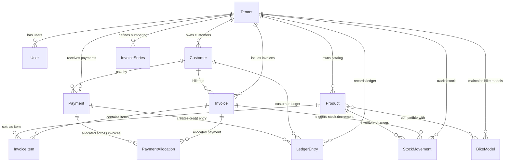

# 06. Database Schema & Data Integrity Reference

## 1. Database Entity-Relationship Diagram

---

## 2. Core Enums (`prisma/schema.prisma`)

| Enum | Allowed Values | Usage |
|---|---|---|
| `Role` | `OWNER`, `MANAGER`, `COUNTER_STAFF` | User permission levels |
| `CustomerType` | `GARAGE`, `RETAILER`, `WALK_IN` | Customer classification & default payment terms |
| `CreditStatus` | `GREEN`, `YELLOW`, `RED` | Customer credit health & risk warning state |
| `InvoiceType` | `TAX_INVOICE`, `BILL_OF_SUPPLY`, `RETAIL_BILL` | GST compliance invoice type |
| `InvoiceStatus` | `DRAFT`, `ISSUED`, `PARTIALLY_PAID`, `PAID`, `DISPUTED`, `CANCELLED`, `CREDIT_NOTED` | Invoice lifecycle state |
| `PaymentMode` | `CASH`, `UPI`, `BANK`, `CHEQUE`, `OTHER` | Method of payment receipt |
| `PaymentStatus` | `CLEARED`, `PENDING`, `BOUNCED` | Payment clearance state |
| `LedgerEntryType`| `INVOICE`, `PAYMENT`, `CREDIT_NOTE`, `DEBIT_NOTE`, `ADJUSTMENT`, `PAYMENT_REVERSAL` | Double-entry khata categorization |
| `StockReason` | `PURCHASE`, `SALE`, `RETURN_IN`, `RETURN_OUT`, `ADJUSTMENT`, `OPENING` | Audit reason for inventory mutation |

---

## 3. Critical Models & Financial Precision

### A. Model `Tenant` (`tenants`)
- `id` (UUID, PK)
- `name` (String), `legalName` (String?), `gstin` (String?), `stateCode` (String?)
- `upiId` (String?), `bankDetails` (Json?), `settings` (Json?)
- Enforces strict multi-tenant isolation across all child models.

### B. Model `Invoice` (`invoices`)
- `id` (UUID, PK)
- `tenantId` (UUID, FK -> `Tenant`)
- `customerId` (UUID?, FK -> `Customer` - null for anonymous walk-in sales)
- `number` (String, unique within tenant per series)
- `status` (`InvoiceStatus`, default `ISSUED`)
- **Monetary Amounts (All BigInt Paise)**:
  - `subtotal` (BigInt): Gross line total before discount
  - `discountTotal` (BigInt): Total invoice and line discounts
  - `taxableValue` (BigInt): Subtotal minus discounts
  - `cgst`, `sgst`, `igst` (BigInt): GST tax components
  - `roundOff` (BigInt): Positive or negative roundoff in paise
  - `grandTotal` (BigInt): Exact final payable amount
  - `paidNow` (BigInt): Cash/UPI collected immediately at billing
  - `amountPaid` (BigInt): Cumulative allocations against this bill
  - `balanceDue` (BigInt): Unpaid balance remaining on credit
- `cancelReason` (String?): Mandatory reason when status becomes `CANCELLED`.

### C. Model `LedgerEntry` (`ledger_entries`)
- **Authoritative Source of Truth**:
  Customer balance is computed as:
  $$\text{Running Balance} = \sum (\text{debit}) - \sum (\text{credit})$$
- `id` (UUID, PK)
- `tenantId`, `customerId` (UUID, FKs)
- `entryType` (`LedgerEntryType`): `INVOICE` (Dr), `PAYMENT` (Cr), `ADJUSTMENT` (Cr/Dr), `PAYMENT_REVERSAL` (Dr)
- `debit` (BigInt paise, default 0)
- `credit` (BigInt paise, default 0)
- `narration` (String): Human-readable audit text (e.g. *"Invoice #INV/2026-27/1042"* or *"Cash Payment Received"*).
- `refId` (UUID?): Link to corresponding Invoice or Payment.

### D. Model `Payment` & `PaymentAllocation`
- `Payment.amount` (BigInt paise): Total received from customer.
- `PaymentAllocation.amount` (BigInt paise): Portion assigned to a specific open invoice.
- **Invariant**:
  $$\sum (\text{PaymentAllocation.amount}) \le \text{Payment.amount}$$
  Any remainder represents an **unallocated advance**.

---

## 4. Key Constraints & Data Invariants Checklist

1. **Integer Paise Representation**:
   - `BigInt` columns are used across all tables (`Invoice`, `Payment`, `LedgerEntry`, `Product`, `StockMovement`).
   - Floats are forbidden in the database schema. Client polyfill in `server/lib/prisma.ts:20` converts `BigInt` to string during JSON serialization.
2. **Sequential Gapless Numbering Invariant**:
   - Schema defines model `InvoiceSeries` with `currentNumber` and `seriesCode`.
   - **Current Violation**: The code in `app/api/v1/invoices/route.ts:166` currently uses `Math.random()` instead of incrementing `InvoiceSeries.currentNumber` with `SELECT ... FOR UPDATE`.
3. **Invoice Immutability**:
   - `AGENTS.md` Rule 2 dictates that issued invoices must not be edited.
   - Code enforces immutability via status transitions to `CANCELLED` instead of raw SQL `DELETE`.
4. **Append-Only Ledger**:
   - Ledger entries are strictly inserted. When an invoice is cancelled or a payment is reversed, a compensatory reversing entry is created, preserving the audit trail.
